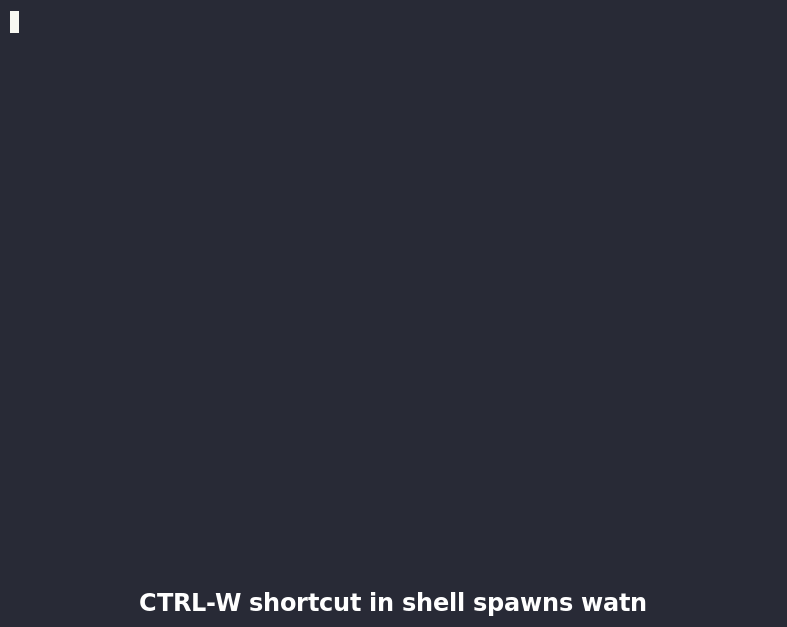
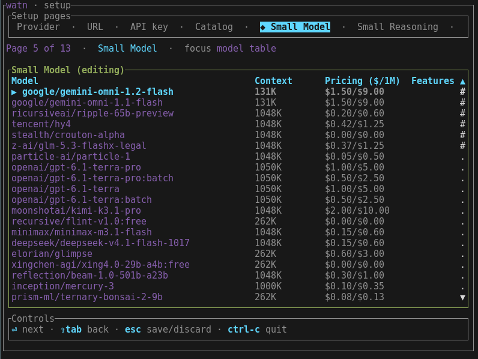
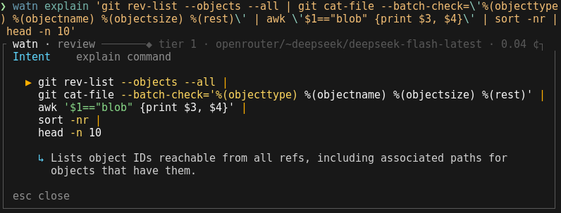

# Watn? ¯\\\_(ツ)\_/¯

<!-- givn:begin:coverage-badge -->
[](coverage/cobertura-coverage.xml)
[](coverage/cobertura-coverage.xml)
<!-- givn:end:coverage-badge -->
[](https://crates.io/crates/watn)

watn sends a plain-language question to a configured OpenAI-compatible endpoint
and prints the answer: a shell command for command requests, text otherwise. In
an interactive terminal, generated commands open in the review surface before
anything reaches stdout; nothing is executed without confirmation.

## Demo

*Ctrl-W with the review surface disabled: the shell buffer is replaced, not executed.*



*`watn "query"` with the review surface: the command flow and model-written stage purposes.*


## Install

```sh
cargo install watn
```

Requires a Rust toolchain and an OpenAI-compatible endpoint with an API key.
Releases are source-only; a GitHub release carries the changelog.

## Quick start

### Quick setup

```sh
watn quicksetup --url https://openrouter.ai/api/v1 --key '${OPENROUTER_API_KEY}' --model '~anthropic/claude-haiku-latest:nitro'
```
### Setup Dialog

```sh
watn setup
```

*The Setup Dialog to configure interactively*


> **Example:** `watn "find all files modified in the last day"` prints:
>
> ```text
> find . -type f -mtime -1
> ```

## Usage

| Invocation | Result |
|---|---|
| `watn "question"` | Prints the generated command |
| `printf "question" \| watn` | Reads the question from stdin |
| `watn -x "question"` | Prompts, then executes with `sh -c` |
| `watn explain '<command>'` | Opens the explanation card |

| Flag | Effect |
|---|---|
| `-1`, `-2`, `-3` | Select the small, normal, or thinking tier |
| `--model <MODEL>` | Use an explicit model instead of a tier |
| `--provider <PROVIDER>` | Select a configured provider |
| `-x` | Execute after confirmation |
| `--review-panel`, `--no-review-panel` | Force the surface on or off and persist the choice |
| `-v` | Print provider reasoning to stderr |
| `watn --help` | Lists every flag and subcommand |

| Stream | Content |
|---|---|
| stdout | The answer or command |
| stderr | Model, tokens/second, elapsed time, cost when known, warnings |

Every flag, keybinding, exit code, and configuration key: [docs/reference.md](docs/reference.md).

## Review surface

The surface opens on the controlling terminal with the model and billed amount
when a price is known, the command flow as a stage stack, and the selected
stage's description.

| Key | Action |
|---|---|
| `↑` `↓` | Move the selected stage |
| `Enter` | Accept |
| `d`, `?` | Toggle the detailed view |
| `e` | Edit the command |
| `r` | Choose another model |
| `Escape` | Cancel |
| `D` | Disable the surface permanently |

The detailed view adds the intent, the command editor, the model chooser, and
the decision hints.

## Explain an existing command

*Explaining a complex command before execution*



```sh
watn explain 'git log --oneline | head -5'
watn explain 'git rev-list --objects --all | git cat-file --batch-check=\'%(objecttype
) %(objectname) %(objectsize) %(rest)\' | awk \'$1=="blob" {print $3, $4}\' | sort -nr | head -n 10'
```

The command reaches watn verbatim as one argument; watn never joins, re-splits,
evaluates, or executes it. `Enter` or `Escape` closes the card without releasing
the command.

## Shell integration

`watn shell` installs completion and an optional Ctrl-W widget for Bash, Zsh,
and Fish. The widget sends the current buffer to watn, records the question in
shell history as a `#` comment, and replaces the buffer with the accepted
command without evaluating it. `watn completions <SHELL>` prints a script for
`bash`, `elvish`, `fish`, `powershell`, or `zsh`.

## Configuration

| Setting | Value |
|---|---|
| File | `$XDG_CONFIG_HOME/watn/config.toml`, normally `~/.config/watn/config.toml` |
| Precedence | `CLI flag → environment variable → config value → built-in default` |
| Credential | Literal value or `${ENV_NAME}` reference; a literal value appears in shell history and process listings |
| File mode | `0600` on Unix |
| Wizards | `watn setup`; `watn provider`, `watn models`, `watn shell` |

## Docs

[Reference](docs/reference.md) · [Architecture](docs/arc42/) · [Decisions](docs/adr/) · [Glossary](docs/glossary.md) · [Domain model](docs/domain-model.md)

## Development

```sh
./run-tests.sh          # not @e2e
./run-tests.sh --e2e    # @e2e
```

The pinned Rust toolchain plus Bash, Fish, and Zsh are required. Tests use mocks
and loopback services, so no provider or API key is needed. Coverage requires
`cargo-llvm-cov` and Python 3.

## License

GPL-3.0-or-later. See [LICENSE](LICENSE).

<!-- givn:begin:coverage -->
## Coverage

Merged report: [coverage/cobertura-coverage.xml](coverage/cobertura-coverage.xml)

Line coverage: 93% (21522/23130)
Branch coverage: n/a (0/0)

Reproduce the result:

```sh
./measure-coverage.sh
./merge-coverages.sh
```
<!-- givn:end:coverage -->
