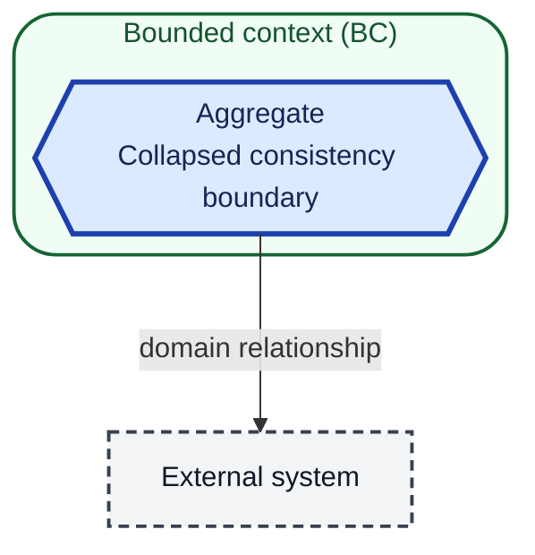
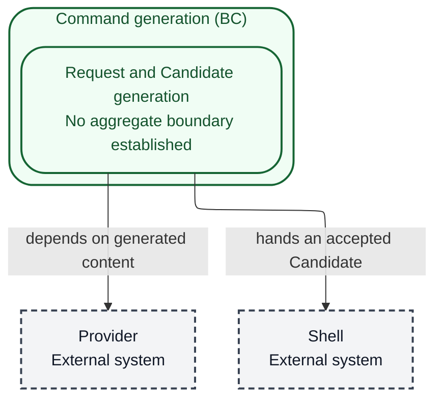

# Domain Model

## Scope and modeling status

This model covers the watn command-generation domain: a developer's natural-language Request becomes a Candidate command through an OpenAI-compatible Provider, is optionally examined in the Review surface, and may be handed to the Shell. The bounded-context view below is established. No aggregate consistency boundaries are established; the project glossary records no aggregate list, and this model does not claim any. Internal module layering and runtime flows belong to arc42 chapters 5 and 6.

## Diagram notation and legend

This is notation only, not part of the domain model. Containment shows bounded-context membership. Read a labeled arrow from source to target; it is a domain relationship, not a runtime call.

A host must include the ELK renderer and honour the configuration. Unsupported hosts may fall back or fail; inspect the rendered result rather than assuming the layout directive alone proves readability.

## Structural overview

One bounded context depends on a Provider for generated command content and hands an accepted Candidate to a Shell. No aggregate boundary is drawn because none is established.

## Boundaries and responsibilities

| Bounded context | Responsibility | Explicitly outside its responsibility |
|---|---|---|
| Command generation | Turns a Request into a Candidate; applies provider, model, credential, and pricing configuration; presents the Review surface; installs shell shortcut and completion integration | LLM generation quality (Provider); shell execution and shell history ownership (Shell); terminal rendering and the developer's terminal configuration |

| Aggregate | Owning context | Consistency responsibility |
|---|---|---|
| none established | Command generation | The glossary declares no aggregate list; no consistency boundary is claimed here |

## Relationships

| Relationship | Domain meaning | Governing contract or specification |
|---|---|---|
| Command generation → Provider | The context depends on an OpenAI-compatible provider for generated command content and reported usage. The provider is external and is never contacted for configuration readiness. | [Provider setup](../givn/specs/configure-provider/usecase.md) and [Fragment: corpus-infra](../givn/specs/fragments/fragment.md) |
| Command generation → Shell | The context produces a Candidate for the developer's shell; only an accepted Candidate crosses into execution. The shell owns execution and its own history. | [Use shell](../givn/specs/use-shell/usecase.md) |
| Command generation → XDG configuration and state | The context reads and writes layered configuration and the unusable-response state file. Configuration is data owned by the context, not a separate bounded context. | [Model configuration](../givn/specs/configure-model/usecase.md), [Interactive configuration](../givn/specs/configure-interactive/usecase.md), and [Request cost](../givn/specs/observe-request-cost/usecase.md) |

## Open modeling questions

- Which entities, if any, form aggregate consistency boundaries inside Command generation? The glossary declares no aggregate list. Resolving this changes only the structural view, not existing behaviour or contracts.
