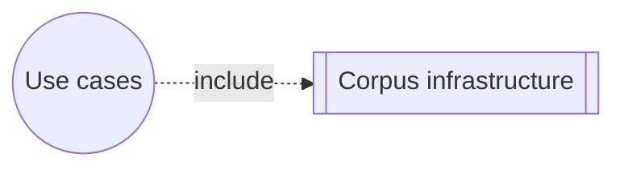

# Fragment: corpus-infra

## Capabilities

- ask
- cancel-running-completion
- config
- incremental-sse-rendering
- release-truth
- search-concurrency
- transport

## Interactions

| Capability | Consumer action | E2E scenario |
|---|---|---|
| ask | ask a question and read the generated command | Ask with default tier returns a copy-pasteable command |
| ask | execute a generated command after Enter confirmation | Execute flag prompts for confirmation |
| cancel-running-completion | cancel a completion while waiting for streamed output | One Ctrl+C cancels a completion waiting for streamed output |
| config | configure model tiers in the config file | Configure model tiers in config file |
| config | configure model pricing for cost display | Model pricing configured for cost display |
| incremental-sse-rendering | read command text before a delayed stream completes | Command text appears before a delayed stream completes |
| incremental-sse-rendering | confirm on a raw terminal after the complete command arrives | Raw terminal confirmation happens after the complete command arrives |
| release-truth | read the package version from the version flag | Version flag reports the package version |
| release-truth | read one changelog entry for repeated revisions of one change | Repeated revisions of one change yield one changelog entry |
| transport | run a normal debug request with test routing settings present | Normal debug requests ignore test routing settings |
| transport | run a test-support request against an isolated provider | Test-support requests use isolated routing without changing saved configuration |

## Diagram

